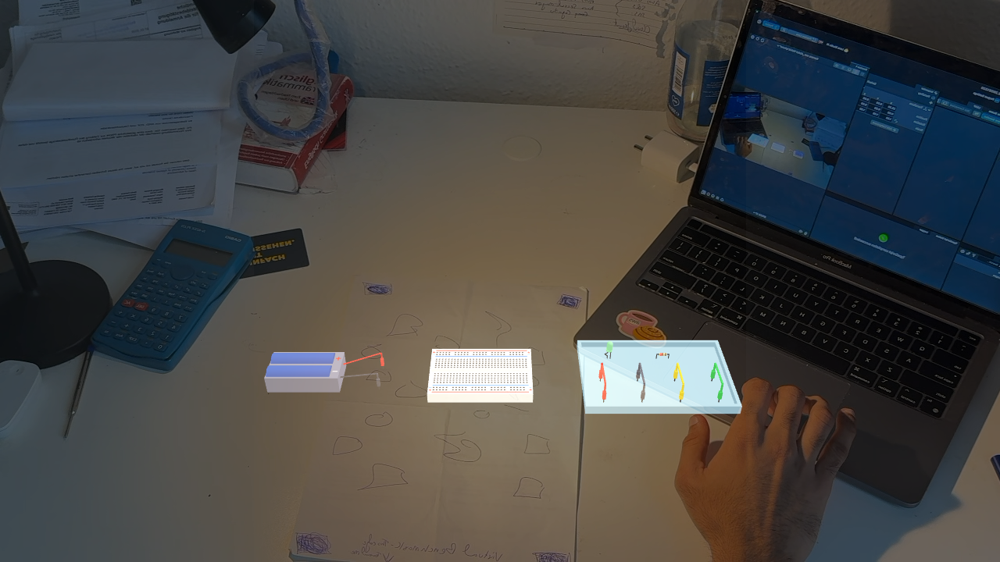
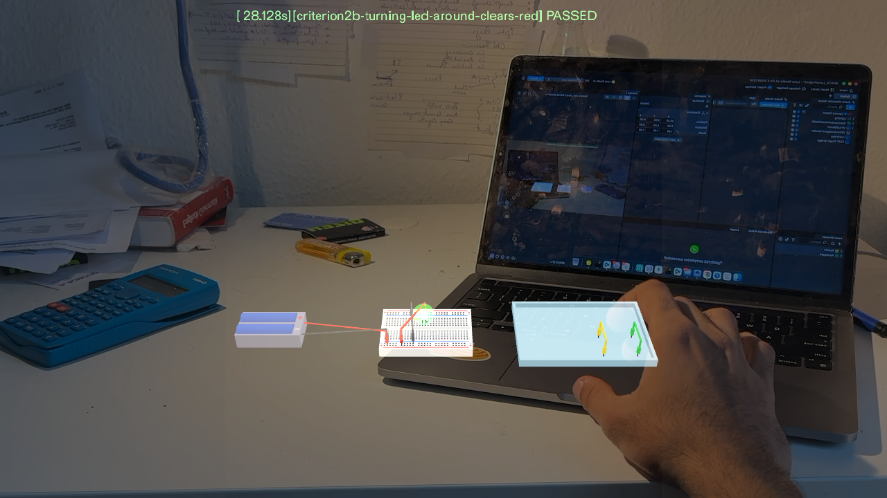
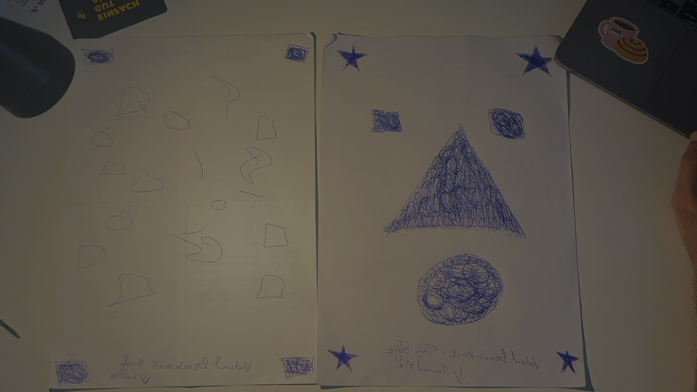
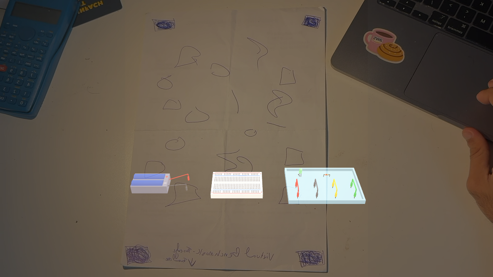
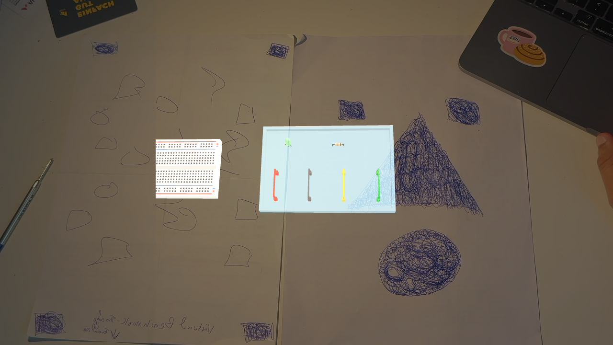

# Virtual Electronics Bench

**A real-size electronics practice bench for Snap Spectacles.** Follow a breadboard tutorial on your real laptop while you build the circuit with your hands on a virtual breadboard lying on your real desk — no parts to buy, nothing to burn out.

Built for the SPECS hackathon with Lens Studio 5.23, TypeScript, the Spectacles Interaction Kit (SIK) and LEAF integration tests.

---

## The idea

Beginners learn electronics from YouTube videos and breadboard tutorials. On a phone or laptop simulator you click tiny icons in a window that also has to show the tutorial. With real parts you need a kit, and a backwards LED or a missing resistor just means "nothing happens" with no hint why.

On glasses the bench lives **on your desk, at real size**:

- Your **laptop stays free** for the tutorial video.
- Your **hands do the building** — pinch a part from the tray, drop it on the breadboard, and it snaps into the nearest row.
- The bench **checks the circuit as you build**. When the battery, 220 Ω resistor and LED form a correct loop, the LED **glows**. Put the LED in backwards and it turns **red right away**.



## What's on the bench

| Item | Details |
|---|---|
| **Breadboard** | Half-size (≈ 8.3 × 5.5 cm), 30 columns, rows a–j split by the center channel, + / − power rails marked red and blue on both sides |
| **Battery pack** | 2 × AA (3 V), with a red (+) and a black (−) lead you plug into the board |
| **Parts tray** | One LED, one 220 Ω resistor (red-red-brown-gold bands) and up to four jumper wires |
| **LED** | Long, kinked leg = anode (+); flat rim on the cathode (−) side — so you can see which way it faces |

Everything is modelled at real-world scale in centimetres and built procedurally in code (no imported 3D models).

## How to use it

1. **Pick up a part** — pinch it in the tray (either hand). Every small part has a grab zone larger than its visible size, because real-size parts are tiny.
2. **Place it** — drag it over the breadboard and let go. A marker shows the hole(s) it will snap into, then it locks into the nearest free row.
3. **Wire it up** — drag each jumper-wire end and each battery lead onto a hole.
4. **Turn the LED around** — a quick pinch on a placed LED or resistor flips it in place.
5. **Move or remove** — grab a placed part again, or drop it off the board and it slides back to its tray slot.

### What the LED tells you

| LED | Meaning |
|---|---|
| ⚪ Off | The circuit is not complete yet |
| 🟢 Glowing | Battery + → resistor → LED → battery − (or LED first, then resistor) is a complete, correct loop |
| 🔴 Red | The LED is in backwards relative to the battery's + and − |



## Demo mode and drop guide

For a short demo video, turn on **Demo Prebuild** on the `BenchController`. The Lens then starts with the battery leads, resistor and both wires already on the board, and only the LED left in the tray — the demo ends on the one placement that lights it:

```
+ rail → wire → column 10 → 220 Ω → column 14 ── LED ── column 15 → wire → − rail
```

With **Show Drop Guide** on (default), the bench shows exactly where the LED goes:

- red and blue pads on **e14** (long leg, +) and **e15** (flat side, −), inside a pulsing outline
- **+ / −** labels in the center channel next to them
- bouncing arrows over the LED in the tray and over the target holes
- a dotted path flowing from the tray to the target

The guide disappears as soon as the LED glows. Refresh the preview to run the demo again.

## Putting the bench on your real desk

Lens Studio's webcam preview has no head tracking, so the bench can sit on a **printed image marker** instead:

1. Print [`docs/BenchMarker_print_A4.pdf`](docs/BenchMarker_print_A4.pdf) and lay it flat on your desk, with the edge marked "toward me" facing you.
2. Point the webcam at it — the bench lies flat on the marker, board in the center.
3. A second, mirrored marker is included for webcams (e.g. iPhone Continuity Camera) that send a mirrored image.
4. An optional small **close-up card** lets the bench stay put when the camera is too close to see the big marker: once both are seen together, the bench follows the card alone.

| Printed markers | Bench on the marker | Close-up of board and tray |
|---|---|---|
|  |  |  |

Marker tracking is smoothed and ignores single-frame jumps (a common glitch when the marker is half out of view). **Lock After First Scan** freezes the bench once it has been placed — useful on glasses, which track their own movement, or with the webcam on a stand.

## Project structure

```
Assets/
├── Scene.scene                 Main scene (camera, bench roots, marker trackers, LEAF)
├── Scripts/
│   ├── BenchController.ts      Builds the bench, handles grab / snap / flip, marker following,
│   │                           webcam layout, demo prebuild + drop guide, LED visuals
│   ├── BenchPart.ts            One grabbable part: SIK Interactable, oversized grab zone, tap vs drag
│   ├── BreadboardModel.ts      Hole grid, nets (which holes are connected), snapping math
│   ├── CircuitChecker.ts       Decides off / glow / reversed from what is plugged in (union-find over nets)
│   └── BenchMeshes.ts          Procedural meshes (box, cylinder, sphere, hole grid) and materials
├── Tests/                      LEAF integration tests (one per done criterion, plus the demo)
├── Materials/                  PBR + unlit materials cloned at runtime for every color
├── Textures/                   Desk marker images (normal and mirrored)
└── Render/                     Camera texture, render target, environment map
Packages/                       Spectacles Interaction Kit, Spectacles UI Kit, LEAF, Icons, Motion
devpost/
└── design-brief.md             The design brief from the Devpost Learn skill pack (plan-lens)
docs/
├── BenchMarker_print_A4.pdf    Printable desk marker
└── images/                     Screenshots used in this README
```

### How the circuit check works

`CircuitChecker.ts` doesn't simulate current or voltage. It answers two questions from what is connected:

1. **Is the LED backwards?** It joins every set of connected holes (a breadboard column, a power rail, the two ends of a jumper wire) into nets with union-find, then looks at which battery terminal the LED's anode and cathode trace back to.
2. **Is the loop complete?** Battery + → resistor → LED anode, LED cathode → battery − — or the LED first and the resistor second. If so, the LED glows.

## Tests

The design brief's done criteria each have a [LEAF](https://developers.snap.com/) scenario that drives the real Lens in Lens Studio's preview:

| Scenario | Checks |
|---|---|
| `criterion1-led-snaps-into-row` | Dragging the LED onto the breadboard snaps it into a row |
| `criterion2-backwards-led-turns-red` | An LED placed backwards in the circuit turns red |
| `criterion2b-turning-led-around-clears-red` | Flipping a backwards LED clears the red |
| `criterion3-correct-circuit-glows` | Battery, 220 Ω resistor, LED and wires connected correctly → LED glows |
| `demo-last-step-led-glows` | With Demo Prebuild, placing the LED in e14–e15 lights it |

Run them from the **LEAF** panel in Lens Studio.

## Running it

1. Install **Lens Studio 5.23** or newer.
2. Clone this repo and open `SPECS_LensProject.esproj`.
3. In the Preview panel, pick a Spectacles device:
   - **Interactive Preview** — walk around with WASD, Q/E for down/up, right-drag to look, click to pinch.
   - **Webcam** — turn on **Webcam Mode** on `BenchController` and point the camera at the printed marker.
4. To try it on Spectacles, use **Preview Lens / Send to Device**.

### `BenchController` settings

| Group | Setting | What it does |
|---|---|---|
| Settings | Show Desk Stand-In | Virtual desk for the preview; turn off on real glasses |
| Settings | Jumper Wire Count | 1–4 wires in the tray |
| Settings | Snap Margin Cm | How far past the board's edge a drop still snaps in |
| Webcam preview | Webcam Mode, Gap, Tilt, Drop | Lays the bench out straight ahead, tilted toward a fixed camera |
| Desk marker | Marker trackers, Lock After First Scan, Smoothing, Jump Cm | Places and steadies the bench on the printed marker |
| Demo | Demo Prebuild, Show Drop Guide | Pre-wired circuit with only the LED left, plus the drop guide |
| Debug | Debug Colliders | Draws every part's grab zone |

## Limitations and next steps

- Only LED direction and the LED + resistor loop are checked — no short-circuit or missing-resistor warnings yet.
- The preview drives one hand with the mouse, so two-handed moves can't be shown there.
- Real-size parts are tiny; snapping and oversized grab zones help, but comfort on real glasses is still to be tested.
- Ideas: Arduino / ESP32 as a power source, more components (buttons, buzzers), guided projects, soldering practice.

## Credits

Built during the SPECS hackathon. Made with Lens Studio, Spectacles Interaction Kit, Spectacles UI Kit and LEAF by Snap Inc.
